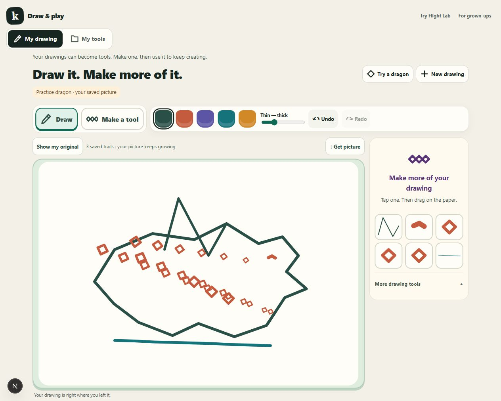
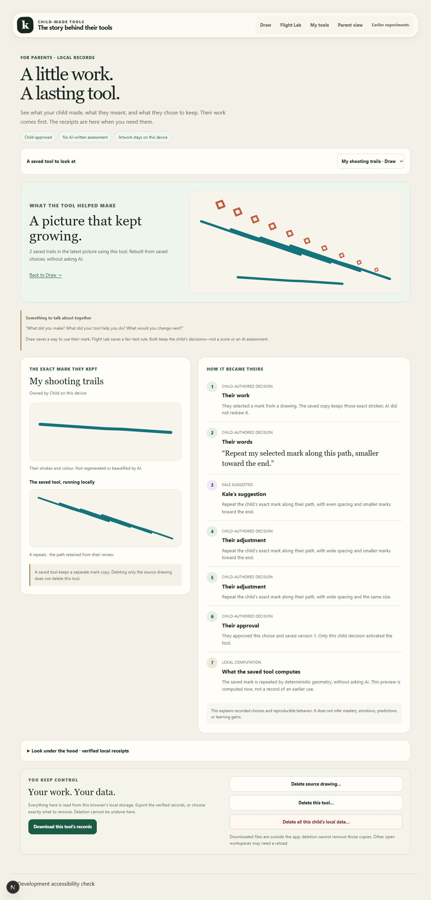

# Creative loop verification — 23 October 2026

## What changed

The output is now a picture made with a child-approved tool, not only an isolated pattern preview. After approval, **Draw with my tool** keeps the reviewed trail on the existing canvas. Further gestures add trails rather than replacing the last one. Hand drawing, separate pattern undo, reopening and picture download remain available. My tools can return a chosen tool to this canvas; its separate playground is explicitly practice paper.

Parent view shows the latest local picture using the selected tool, followed by the exact source mark and the distinct intent, suggestion, edits and approval. It suggests a family conversation, not an assessment. Flight Lab stays visible as a second application of the same approval/version primitive.

## Small architecture delta

- Optional `DrawDocument.applications`: unique ID, tool ID, pinned approved version ID, child-directed path, timestamp. Maximum 24 paths; no database migration or object store.
- Original strokes and source digest remain separate from derived artwork. No model receives/regenerates the mark.
- Pure `renderToolApplications` verifies tool graphs, resolves exact approved versions and executes the existing deterministic geometry. Later active versions do not silently restyle earlier artwork.
- Combined derived output is bounded at the existing preview point/stroke budgets. Missing/deleted/damaged tools are hidden and disclosed, not reconstructed from cached source copies.
- Writes use the existing ordered CAS/owner-generation queue. This does not add an AI approval path or modify an immutable tool/version/ledger/snapshot.
- Per-tool export does not bundle another referenced tool’s private graph. Cross-tool references may be unresolved outside this browser.

## Actual browser checks

Fresh local origin `http://127.0.0.1:3023`, separate from the earlier user workspace.

1. Opened Draw, loaded the labelled dragon, selected an orange mark, dragged a path, reviewed and explicitly saved **My dragon scales**.
2. **Draw with my tool** stayed on that picture and retained the first trail. Two further gestures made three saved trails. Added a teal hand-drawn line. Reload preserved all three trails and seven original strokes.
3. My tools → **Use in my picture** returned to the same canvas. Pattern undo reduced three trails to two without deleting original strokes. Keyboard path creation added another saved trail.
4. At 390×844, Draw/library and Parent view had no horizontal page overflow. The direct library route could resume the kept picture. Saved-tool controls wrap; keyboard path controls were usable. This is responsive browser inspection, not testing on a physical phone.
5. Started a blank drawing, reused the earlier saved tool without redrawing its source, and reopened the saved result successfully.
6. Exercised the live local AI route once: “Repeat my selected mark along this path, smaller toward the end.” The server returned HTTP 200; the UI showed **Even spacing · getting smaller** as an unapproved suggestion.
7. Opened that review, changed spacing to wide and size to constant, named **My shooting trails**, and explicitly approved it. Parent view separately showed the original words, Kale’s even/smaller suggestion, both child adjustments and the child approval. The model did not approve anything.
8. Parent view showed the actual composed picture and a factual saved-trail count. Browser console check returned no warnings/errors in the inspected flow. Server logs show local page responses and the one teaching request; manual creation/reuse required no teaching call.
9. Reopened the same records in `next start` after the production build. My tools returned focus to the correctly named drawing paper. A real SVG download contained 15 polylines (one hand-drawn source + 14 derived lines), no scripts.
10. In the production build, Flight Lab’s manual preview changed Dart → Falcon while still labelled unsaved. Explicit approval saved the rule; reload still excluded both obstructed throws, kept the clear 8.9 m throw and showed Falcon leading. It uses the same approval/version persistence boundary as Draw.

No browser data was permanently deleted for these checks. Automated repository tests cover tool deletion hiding trails while retaining original strokes in both memory and IndexedDB.

## Automated gates

- `npm run typecheck`: passed (also checked by the production build).
- `npm run lint`: passed, including the final focus/label changes.
- `npm run build`: passed; Draw, library, Flight, Parent and the two existing agent routes present.
- Post-build `npm test -- --maxWorkers=2`: **127 files, 421 tests passed**, no todos.

New integration tests cover both persistence adapters, original-source preservation, immutable capability records, reload-equivalent deterministic output, unique render IDs, missing/deleted/wrong-tool rejection, version pinning with a later approved version, zero fetch calls, duplicate/25th application rejection and combined geometry limits.

## Research and limitations

The accessible [Tim Pietrusky LinkedIn profile](https://de.linkedin.com/in/timpietrusky) contains posts emphasizing child creation, returning the next day and involving the grown-up. The index labels those posts in weeks and was crawled earlier; they are not verified as October 22–23 posts. [Max Forsey’s official profile](https://www.linkedin.com/in/max-forsey) was also checked. Direct recent activity reached LinkedIn’s sign-in wall. The specific new post the user saw remains unverified without its URL or text; no new product claim was inferred from it.

Local AI success does not establish production AI health. Earlier production teaching returned `503 provider_unavailable`; project access through the connected Vercel account returned `403`, so production credentials/logs remain unverified. No secrets were copied into evidence or client code.

This remains a local-first two-slice prototype, not a complete Kale operating system, authenticated parent service or independently tested child-learning product. There is no multi-picture gallery: the child studio reopens the latest saved drawing. Pattern undo has no pattern-redo control. Picture references are current composition state, not complete usage telemetry. No learning gains or emotions are inferred.
